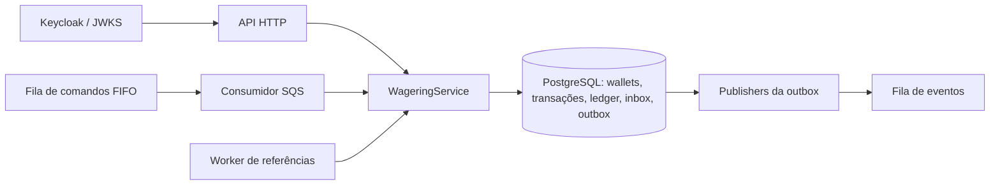

# Arquitetura do Distributed Wagering Processor

## Responsabilidades e execução

O PostgreSQL é a autoridade sobre saldo, identidade das operações e efeitos financeiros. HTTP, consumidor SQS e worker de referências usam o mesmo `WageringService`. A correção não depende de memória compartilhada, da ordem das requisições nem da deduplicação do broker.

A API NestJS roda em processos Bun separados. `worker.ts` permite executar consumidor, publisher e referências juntos ou escolher um papel com `WORKER_ROLE`. Cada processo abre seu próprio pool PostgreSQL. Isso permite escalar os papéis separadamente; a unidade de concorrência financeira continua sendo a wallet.

Os diretórios separam domínio, aplicação, HTTP, persistência, mensageria, autenticação e observabilidade. O domínio não importa NestJS nem MikroORM. O runtime compila TypeScript antes de executar para preservar metadata de decorators exigida pelo NestJS.

## Dinheiro e modelo de domínio

`Money` guarda centavos em `bigint`, com moeda separada. Entrada e saída usam strings decimais com exatamente duas casas. Não há conversão de dinheiro para `number`, arredondamento implícito ou representação em ponto flutuante. Strings vazias, valores numéricos, notação científica, `NaN`, `Infinity`, escala diferente de duas casas e negativos em contratos de entrada são recusados.

O limite financeiro é `9223372036854775807` centavos, correspondente ao máximo positivo de `BIGINT`. Operações internas podem produzir valores negativos dentro do intervalo simétrico, por exemplo na diferença de reconciliação. Parsing e aritmética verificam o limite antes do SQL. `Money` é imutável; somar, subtrair ou negar retorna outra instância. Operações entre moedas diferentes falham.

A aplicação abre wallets apenas em `BRL`. O modelo monetário continua aceitando outras moedas e testa conflitos entre elas. Uma submissão com moeda válida, mas diferente da wallet, pode ser registrada como rejeitada para manter a tentativa auditável.

`Wallet` encapsula saldo, versão e atualização. Crédito e débito exigem valor positivo; débito nunca pode produzir saldo negativo. A versão usa o mesmo limite do `INTEGER` PostgreSQL: `2147483647`. A última transição até esse valor é permitida; movimentos posteriores recebem `WALLET_VERSION_OVERFLOW` antes de alterar saldo, versão ou timestamp. A factory do ledger aplica o mesmo limite.

As entidades usam construtores privados e factories explícitas. `create`/`open` validam criação e transições; `rehydrate` reconstrói estado persistido sem reaplicar regras de transição. Datas são copiadas na entrada e nos getters. O ledger é imutável também em memória e sua factory valida a aritmética `saldo anterior ± valor = saldo posterior`.

Toda wallet nasce na versão 1. Abertura positiva cria uma transação interna `OPENING`, um crédito no ledger na versão 1 e os eventos correspondentes. Abertura zero mantém a versão 1 sem criar transação financeira ou lançamento. Nesse caso, o primeiro movimento financeiro usa a versão 2. `LOSS` não altera versão.

## Transação SQL e concorrência

Cada execução usa `EntityManager.fork().transactional()`. O mapeamento MikroORM `WalletRecord` usa `BigIntType('bigint')`, e o agregado é reconstruído com `Money.fromMinorUnits`. O Unit of Work persiste a mudança da wallet. Inserts, buscas de idempotência, ledger, inbox, outbox e operações de lease usam SQL explícito pelo `EntityManager` da mesma transação.

O caso de uso conhece MikroORM e o schema de persistência. Essa é uma escolha de simplicidade: as garantias de lock, unicidade e commit ficam visíveis em um único fluxo, sem uma camada de repositórios genéricos que apenas repita o SQL. O custo é maior acoplamento do orquestrador ao PostgreSQL/MikroORM. As regras financeiras permanecem nas classes de domínio.

A ordem de aquisição dos locks é consistente:

1. Inbox por `(consumerName, messageId)`, quando a entrada vem da fila.
2. Transação própria por idempotency key, com `FOR UPDATE`.
3. Wallet com `FOR NO KEY UPDATE`.

O lock da wallet serializa movimentos na mesma conta. Wallets diferentes não compartilham um lock global. `NO KEY UPDATE` é intencional: inserir uma transação com FK para a wallet adquire `KEY SHARE`. Usar depois `FOR UPDATE` em duas apostas distintas poderia criar um deadlock de promoção de locks. `NO KEY UPDATE` é compatível com essas verificações de FK e impede movimentos concorrentes sobre saldo e versão, que não são colunas de chave.

Referências são lidas sem lock próprio depois do lock da wallet. Uma referência válida pertence à mesma wallet; operações terminais não mudam mais de estado. Referências pendentes aguardam em vez de criar uma cadeia de locks entre transações. Replays terminais devolvem o resultado salvo sem adquirir lock financeiro da wallet.

Saldo, transação, ledger, resposta persistida, inbox aplicável e eventos da outbox são confirmados juntos. Falha antes do commit desfaz o conjunto completo. A publicação SQS acontece em outro fluxo, depois desse commit.

### Garantias do schema

O schema aplica, além das validações da aplicação:

- Unicidade de wallet por jogador/moeda, idempotency key global e identidade `(providerId, externalTransactionId)`.
- Um lançamento por transação/wallet e uma entrada por versão da wallet.
- Uma única reversão processada por `referenceTransactionId`, independentemente de ser REFUND ou ROLLBACK.
- Inbox única por consumidor/mensagem; outbox identificada pelo `eventId` persistido.
- Saldos não negativos, valores financeiros exatos, aritmética dos lançamentos e relações por FK.
- Proibição de `UPDATE`, `DELETE` e `TRUNCATE` no ledger e de alteração de transações terminais.

Triggers diferidos conferem a correspondência entre transação processada e ledger, direção, valor, identidade da wallet e referência, continuidade entre versões e igualdade entre o último saldo do ledger e o saldo materializado. Essas verificações usam buscas indexadas pela transação ou pela versão anterior/mais recente da wallet. O processamento de cada aposta não soma o histórico inteiro. Um trigger diferido adicional verifica o sucessor da abertura: ele impede inserir uma abertura retroativa na versão 1 depois de uma wallet zerada já ter recebido seu primeiro movimento na versão 2. Abertura e movimento seguinte na mesma transação SQL continuam permitidos quando os saldos são contíguos. O bloqueio de `TRUNCATE` também protege a exclusão em massa do ledger.

A FK da transação exige que a wallet exista. A identidade completa de jogador/moeda é conferida para transações processadas, permitindo persistir tentativas rejeitadas por divergência de identidade. Uma wallet inexistente resulta em `404`, sem registro de aposta: não é possível criar esse registro respeitando a FK.

Migrations são versionadas e reversíveis. Os testes executam ida/volta e tentam violações diretamente por SQL, incluindo mutação do ledger e mudanças de saldo sem lançamento correspondente.

## Idempotência e resposta original

O header `Idempotency-Key` é obrigatório no HTTP e é a fonte da verdade. Na fila, o consumidor fornece ao mesmo caso de uso a key presente em `data.idempotencyKey`.

O hash é SHA-256 de JSON canônico: chaves de objetos são ordenadas recursivamente, e a ordem de arrays é preservada. O subconjunto de negócio contém provedor, identidade externa, jogador, wallet, rodada, jogo, tipo, dinheiro normalizado e referência externa quando informada. Header, envelope SQS e outros metadados de transporte não entram nesse hash.

O insert usa `ON CONFLICT DO NOTHING`, e a execução consulta e bloqueia a linha da key. Payload divergente na mesma key resulta em `IDEMPOTENCY_CONFLICT`. Reutilizar a identidade externa do provedor com outra key resulta em `EXTERNAL_IDENTITY_CONFLICT`. Nenhum desses casos é tratado como replay.

O resultado terminal salvo inclui id interno, status, saldo observado naquele processamento e código de falha quando existente. Replay devolve esse snapshot com `idempotentReplay: true`, mesmo que outras operações já tenham alterado a wallet. `PROCESSED`, `REJECTED` e `FAILED` são terminais; `PENDING` e `PENDING_REFERENCE` ainda podem transicionar.

Uma aceitação pendente não congela o processamento financeiro: retry HTTP pode tentar resolver novamente a referência usando o mesmo id e a mesma data de criação. A inbox tem outra responsabilidade: uma mensagem já aceita e confirmada mantém seu snapshot de aceitação, inclusive `PENDING_REFERENCE`, e pode receber ack. O worker de referências conclui a operação independentemente do redelivery dessa mensagem.

## Operações e referências

| Operação | Efeito | Regra adicional |
| --- | --- | --- |
| `BET` | Débito | Exige saldo suficiente. |
| `WIN` | Crédito | Referência BET opcional; payout pode diferir do valor apostado. |
| `LOSS` | Nenhum | Aceita zero ou positivo; emite processamento sem ledger, mudança de saldo ou versão. |
| `REFUND` | Crédito | Exige BET processada e reversão integral. |
| `ROLLBACK` | Inverso da referência | Reverte BET por crédito e WIN/REFUND por débito, sempre pelo valor integral. |

Quando informada, a referência é resolvida por provedor e id externo, e precisa corresponder a jogador, wallet, moeda e rodada. Referências ausentes ou pendentes deixam a operação em `PENDING_REFERENCE`. Referência rejeitada ou permanentemente falha causa uma rejeição específica. Autorreferência é contrato inválido.

Não existe exclusividade adicional entre WIN e LOSS da mesma BET. Uma referência só pode ter **uma reversão processada**, considerando REFUND e ROLLBACK em conjunto. Depois de BET de `25.00` e REFUND, um ROLLBACK que ainda referencia a BET recebe `REVERSAL_ALREADY_PROCESSED`, sem novo crédito. Para desfazer o REFUND, o ROLLBACK deve referenciar o próprio REFUND e debitar seu valor; isso não torna a BET original reversível novamente. WIN e LOSS que referenciam a BET não contam como reversões, e tentativas rejeitadas não consomem a referência. A aplicação verifica a exclusividade sob lock da wallet antes dos efeitos, e o índice único parcial em `reference_transaction_id` reforça a garantia no banco.

A migration `Migration20261026000100` substitui o índice de reversão por referência/tipo sem reescrever transações ou ledger. Se o banco já contiver REFUND e ROLLBACK processados sobre a mesma referência, a criação do índice falha e a migration inteira é desfeita, preservando dados e índice anterior. Esse histórico exige auditoria financeira e uma estratégia explícita de migração; não há reparo automático. A atualização deve ser coordenada para retirar os writers com a regra antiga antes de retomar o processamento.

Reversão parcial é rejeitada. Um rollback que precisaria debitar mais que o saldo disponível recebe `REVERSAL_INSUFFICIENT_FUNDS`, distinto de `INSUFFICIENT_FUNDS` de BET. A rejeição permanece persistida sem ledger ou mudança de versão.

O worker de referências seleciona linhas vencidas sem reter locks e chama `reprocess`. O caso de uso bloqueia a própria transação e confere novamente status e `next_attempt_at`; assim, dois workers que selecionaram a mesma linha não contabilizam duas tentativas. O backoff persistido começa em 1 segundo, dobra e limita em 60 segundos. Retry HTTP pode antecipar uma tentativa, mas nunca renova a criação persistida.

O TTL é de 24 horas desde `created_at`, fornecido pelo banco. Tanto HTTP quanto worker comparam esse instante com o relógio PostgreSQL. Ao expirar, a operação vira `REJECTED/REFERENCE_EXPIRED` e gera o evento de rejeição. O evento de pendência é emitido apenas na primeira transição para pendência, não em cada tentativa.

## Contratos HTTP e códigos estáveis

| HTTP | Significado |
| --- | --- |
| `201` | Wallet criada. |
| `200` | Transação processada, inclusive LOSS e replay processado; consultas e reconciliação concluídas. |
| `202` | Aceita com processamento pendente. |
| `400` | Contrato, escala, tipo, referência exigida, identificador ou cursor inválido. |
| `401` / `403` | Token inválido ou escopo/role insuficiente. |
| `404` | Wallet ou transação inexistente. |
| `409` | Identidade de wallet, idempotência, identidade externa ou inbox conflitante. |
| `422` | Rejeição financeira ou de referência, incluindo replay rejeitado. |
| `503` | Infraestrutura indisponível; também é usado para um resultado terminal `FAILED`, identificado pelo corpo com `status` e `failureCode`. |

As respostas de erro de contrato/infraestrutura usam `code` e `message`. Resultados financeiros rejeitados ou falhos usam `transactionId`, `status`, `balance`, `failureCode` e `idempotentReplay`. O cliente deve inspecionar esse resultado terminal antes de decidir reenviar; repetir uma operação `FAILED` não reabre seu estado.

| Grupo | Códigos relevantes |
| --- | --- |
| Contrato | `INVALID_REQUEST`, `INVALID_MONEY`, `INVALID_CURRENCY`, `UNSUPPORTED_CURRENCY`, `INVALID_TRANSACTION_KIND`, `INVALID_TRANSACTION_AMOUNT`, `INVALID_REFERENCE`, `REFERENCE_REQUIRED`, `INVALID_PROVIDER`, `INVALID_CURSOR`. |
| Identidade/conflito | `WALLET_ALREADY_EXISTS`, `IDEMPOTENCY_CONFLICT`, `EXTERNAL_IDENTITY_CONFLICT`, `INBOX_MESSAGE_CONFLICT`. |
| Saldo/modelo | `INSUFFICIENT_FUNDS`, `REVERSAL_INSUFFICIENT_FUNDS`, `CURRENCY_MISMATCH`, `WALLET_PLAYER_MISMATCH`, `MONEY_OVERFLOW`, `WALLET_VERSION_OVERFLOW`. |
| Referência | `REFERENCE_MISMATCH`, `REFERENCE_REJECTED`, `REFERENCE_FAILED`, `INVALID_REFERENCE_KIND`, `REFERENCE_AMOUNT_MISMATCH`, `REVERSAL_ALREADY_PROCESSED`, `REFERENCE_EXPIRED`. |
| Recursos/infraestrutura | `WALLET_NOT_FOUND`, `TRANSACTION_NOT_FOUND`, `INFRASTRUCTURE_UNAVAILABLE`, `DEPENDENCIES_UNAVAILABLE`. |
| Autorização | `INVALID_ACCESS_TOKEN`, `INSUFFICIENT_ROLE`, `PROVIDER_ACCESS_DENIED`. |
| Mensageria | `INVALID_COMMAND_ENVELOPE`, `INVALID_COMMAND`, `RETRY_EXHAUSTED`, `PROCESSING_FAILED`; falhas permanentes preservam o código auditado. |

`MONEY_OVERFLOW` pode aparecer como `400` quando o próprio valor de entrada excede o limite, ou como rejeição financeira quando uma operação válida faria o saldo ultrapassá-lo. Códigos de erro de programação, como tentativa de alterar entidade terminal, não são convertidos em rejeições financeiras silenciosas.

## Inbox, SQS e recuperação

As filas são `wager-transactions.fifo`, `wager-transactions-dlq.fifo` e a fila standard `wager-events`, separada para eventos. FIFO auxilia a ordenação dos comandos; o banco continua responsável pela correção. Os testes enviam o mesmo id lógico com deduplication ids distintos para exercitar a inbox sem depender da janela de deduplicação FIFO.

O hash da inbox inclui a idempotency key e os campos canônicos de negócio. Reutilizar `(consumerName, messageId)` com outra key ou payload gera conflito permanente. Marcar a inbox como processada participa da mesma transação financeira, inclusive quando a operação já havia sido processada por HTTP e a entrada SQS apenas registra o replay.

O consumidor faz ack depois que o caso de uso retorna do commit. Rejeição de negócio é terminal e recebe ack; infraestrutura transitória recebe retry com visibilidade/backoff. O limite padrão é cinco recebimentos. Envelope inválido e falhas permanentes seguem para DLQ; esgotamento usa `RETRY_EXHAUSTED`.

Quando o comando é válido e o banco está acessível, `failSubmission` persiste `FAILED`, snapshot, inbox e `WagerTransactionFailed` sem aplicar dinheiro. Essa auditoria não substitui resultado terminal anterior: falhar o ack de uma aposta já processada não pode transformá-la em FAILED. Se o banco estiver indisponível, o original pode chegar à DLQ sem auditoria SQL de FAILED; corpo e metadados do broker permanecem a evidência recuperável.

A visibilidade é renovada enquanto a mensagem está em andamento. No desligamento, o consumidor tenta drenar por até dez segundos e devolve visibilidade das restantes. Um handler que termina depois da devolução não pode fazer ack com aquela posse antiga; os locks e a idempotência protegem uma eventual sobreposição financeira.

## Outbox e entrega de eventos

Os eventos têm subclasses concretas e envelope versionado: `WagerTransactionProcessed`, `WagerTransactionRejected`, `WagerTransactionPendingReference`, `WalletBalanceChanged` e `WagerTransactionFailed`. Dinheiro no payload já está serializado em strings. `WalletBalanceChanged` existe somente quando há mudança efetiva de saldo.

Publishers concorrentes reivindicam lotes com `FOR UPDATE SKIP LOCKED`, gravam lease e token de posse e fazem o envio fora da transação de reivindicação. O lease é renovado durante o trabalho. Atualizações de sucesso/retry conferem id, token e, no sucesso, lease ainda válido. Um publisher que perde a posse não pode registrar sucesso usando um token antigo; um lease abandonado permite que outro processo retome o envio.

A entrega é **at-least-once**. Se o SQS aceitar um evento e o processo morrer antes de gravar `published_at`, haverá republicação. O `eventId` e o payload originais são preservados. Consumidores downstream precisam deduplicar por `eventId`; a solução não promete entrega exactly-once. Eventos da fila standard também podem chegar fora de ordem. `walletVersion` nos eventos de saldo permite ao consumidor reconhecer a sequência financeira.

Falha de envio agenda retry persistido; o registro confirmado na outbox não é removido. A reconciliação do saldo não depende da disponibilidade do broker.

## Consultas, observabilidade e autenticação

O ledger usa cursor opaco contendo wallet, última versão lida e teto de versões da primeira página. Novos lançamentos não deslocam o histórico já em navegação. A reconciliação usa uma única instrução SQL para ler saldo materializado e soma do ledger no mesmo snapshot PostgreSQL, inclusive durante escritas concorrentes. Ela devolve diferença e consistência, registra divergências e não corrige saldos silenciosamente.

Logs JSON incluem os identificadores disponíveis de correlação, mensagem, transação, wallet e provedor, além de status, código e duração. A escrita usa uma lista explícita de campos; não registra payload financeiro completo, saldos, tokens ou segredos. Diagnósticos não alteram o resultado financeiro confirmado.

As métricas Prometheus cobrem resultados por status, duplicatas, retries, DLQ, conflitos de lock, inconsistências de reconciliação, latência e idade do evento mais antigo da outbox. Contadores e histogramas são locais a cada processo e reiniciam com ele; devem ser coletados de todas as instâncias. A contagem por status representa execuções observadas, e uma nova tentativa pendente pode ser contada novamente. O lag da outbox é consultado no banco.

A API expõe `/metrics` para operador. Cada worker abre um servidor operacional em `127.0.0.1`, com porta configurável por `WORKER_METRICS_PORT`; a porta padrão `0` é dinâmica e o endereço aparece no log de inicialização. Esse endpoint local precisa de coleta por instância e não agrega o cluster.

`/health/live` verifica vida do processo. `/health/ready` verifica PostgreSQL e acesso às filas de comandos/eventos SQS. Readiness falha com `503` se as dependências não estão alcançáveis. Os dois health checks permanecem públicos.

A autenticação HTTP integra Keycloak por OIDC, usando `client_credentials`. O verificador exige assinatura RS256 válida, issuer, audience, expiração e claims de service account. As chaves públicas vêm do JWKS. Não existe tabela própria de senhas.

Um cliente com role `dwp-provider` só submete operações com seu `providerId` e consulta suas próprias transações. A role `dwp-operator` administra/consulta wallets, ledger, reconciliação e métricas, e pode consultar transações dos provedores. Um token de operador não substitui a identidade de provedor para submeter apostas. A autorização compara identidade do token com body, path ou transação consultada conforme a rota.

Autenticação só é desativada quando `AUTH_ENABLED=false` está explícito para desenvolvimento/testes; sem essa opção, a configuração OIDC é obrigatória. SQS é um canal interno confiável quanto ao transporte, mas o provedor e os demais campos da mensagem passam pelas mesmas validações financeiras.

## Evidências e limites

As execuções de validação da entrega registraram 59 testes unitários, 119 testes de integração e 4 testes de autenticação. A suíte cobre parsing/limites, estados terminais, regras financeiras, SQL direto e migrations, 50 submissões paralelas da mesma aposta, duas apostas de `80.00` disputando `100.00`, wallets independentes e três processos reais. As regressões de reversão verificam REFUND seguido de ROLLBACK e a ordem inversa, a disputa concorrente entre os tipos, reprocessamento de referências pendentes, replay da rejeição, ROLLBACK do próprio REFUND e a proteção do índice por SQL direto. A migration de unicidade é testada em ida/volta e com histórico incompatível, sem alteração de dados financeiros.

Os cenários de falha incluem rollback antes do commit, redelivery após commit antes do ack, dois publishers, retomada de leases, indisponibilidade de PostgreSQL/SQS, referências fora de ordem, expiração e disputa de reprocessamento com HTTP. Os testes de crash usam processos separados e `SIGKILL` em pontos antes/depois do envio e depois do commit antes do ack. Os cenários financeiros conferem reconstrução do saldo pelo ledger, ausência de efeitos duplicados e não negatividade.

Limites assumidos:

- Runtime de aplicação em BRL, embora `Money` modele múltiplas moedas.
- Ledger de movimentos por wallet; não implementa contabilidade de partidas dobradas.
- Versão financeira limitada ao `INTEGER` SQL, com rejeição explícita antes de exceder `2147483647`.
- Casos de uso dependem explicitamente de MikroORM/SQL; não há abstração de repositório independente do banco.
- Identidade de wallet inexistente gera `404` sem transação de aposta persistida.
- Uma indisponibilidade do banco pode impedir auditoria SQL de FAILED antes da DLQ; a mensagem original permanece no broker.
- Métricas são por processo. A fila de eventos exige deduplicação e tratamento de desordem pelos consumidores externos.
- A integração e o experimento de carga usam PostgreSQL e MiniStack locais. Não medem latência de rede, limites, operação multi-AZ ou comportamento de produção do AWS SQS.

## Experimento de carga

`bun run test:load` cria um banco e uma fila de eventos isolados, inicia três APIs reais e dois loops de publisher. Executa cenários de wallet disputada e wallets independentes, cada um com concorrência 1, 10 e 50, aquecimento de 15 segundos e medição de 60 segundos. A carga submete BETs de `0.01 BRL`; os registros de cada cenário usam identidades únicas.

O relatório descarta métricas do aquecimento, registra tempo efetivo, throughput de respostas bem-sucedidas, p50/p95/p99, HTTP/status/falhas, conflitos de lock, deadlocks PostgreSQL, lag e pendências da outbox, retries de publisher, perda de leases e recursos do driver/APIs. A latência inclui falhas e o throughput considera a conclusão das requisições em andamento. No fim, o experimento drena a outbox e reconcilia todas as wallets e identidades antes de declarar sucesso.

### Execução completa registrada

Execução de 25/10/2026, das **19:13:29 às 19:21:33 BRT** (`America/Sao_Paulo`, UTC−03), identificada por `beae85b0-3e5b-4b61-932c-be3dc7c5ff30`. A implementação funcional usada no experimento corresponde ao commit `92deb97`.

| Parâmetro | Ambiente medido |
| --- | --- |
| CPU | AMD EPYC 9V45, 5 CPUs lógicas visíveis, quota efetiva de 4 vCPU (`cpu.max = 400000 100000`). |
| Memória | Limite de cgroup de 16 GiB (`17179869184` bytes). |
| Sistema/runtime | Linux 6.18.55, x64, Bun 1.4.4. |
| Stack | NestJS 12.2.0, MikroORM 7.2.5, PostgreSQL 17.6-alpine, AWS SDK SQS 3.1156.0 e MiniStack 1.5.32. |
| Processos | 3 APIs reais e 2 loops de publisher; driver, PostgreSQL e MiniStack no mesmo host. |
| Autenticação | Desativada explicitamente durante a carga; a integração Keycloak foi validada separadamente. |

Cada linha abaixo representa sua janela de medição, depois dos 15 segundos de aquecimento. RPS considera o tempo efetivo até a conclusão das requisições em andamento. Latências estão em milissegundos; lag é a idade do evento pendente mais antigo, em segundos. Os percentis vêm de um histograma com buckets de 1 ms, portanto não têm precisão submilissegundo. Os máximos de lag/pendências são observações com amostragem de 1 segundo.

| Cenário / concorrência | RPS | p50 ms | p95 ms | p99 ms | Erros | Maior lag observado s | Pico de pendências |
| --- | ---: | ---: | ---: | ---: | ---: | ---: | ---: |
| Wallet disputada / 1 | 269,6 | 4 | 7 | 10 | 0 | 0,033331 | 17 |
| Wallet disputada / 10 | 220,4 | 29 | 143 | 230 | 0 | 0,031704 | 16 |
| Wallet disputada / 50 | 139,6 | 283 | 870 | 1.247 | 0 | 0,035311 | 8 |
| Wallets independentes / 1 | 272,0 | 4 | 7 | 9 | 0 | 0,293948 | 213 |
| Wallets independentes / 10 | 610,7 | 15 | 30 | 40 | 0 | 1,813094 | 2.257 |
| Wallets independentes / 50 | 848,4 | 58 | 94 | 116 | 0 | 49,251390 | 83.385 |

As seis janelas medidas concluíram **141.778 requisições**, todas `HTTP 200 / PROCESSED`, sem erros ou replays inesperados. Incluindo os aquecimentos, foram processadas **176.344 BETs**; a diferença corresponde a 34.566 apostas de aquecimento. A reconciliação final conferiu **64 wallets**, **176.408 lançamentos** — BETs mais 64 aberturas — e a unicidade de todas as keys, identidades externas e efeitos de ledger. Não houve efeito financeiro duplicado, saldo negativo ou divergência de saldo.

Foram confirmados **352.816 eventos na outbox, todos publicados**, com zero pendências ao final. A drenagem depois do tráfego levou **32,0838 segundos**. Todas as APIs permaneceram vivas. Nas janelas observadas, houve zero conflitos de lock reportados pela aplicação e zero deadlocks PostgreSQL. Os publishers registraram zero retries, zero perdas de lease e nenhuma falha de publicação.

### Interpretação e alcance

Na wallet disputada, elevar a concorrência de 1 para 50 reduziu o throughput de 269,6 para 139,6 RPS e elevou o p99 de 10 para 1.247 ms. Os movimentos sobre a mesma wallet precisam ser serializados; mais clientes aumentaram a espera sem ampliar a capacidade desse agregado. Não houve perda de atualização ou quebra de saldo nesse cenário.

Wallets independentes aproveitaram o paralelismo: com concorrência 50, o resultado foi 848,4 RPS e p99 de 116 ms. Entretanto, a confirmação financeira ficou à frente da publicação: essa janela começou com 17.420 eventos pendentes e terminou com 83.161, chegando ao pico observado de 83.385 e a lag de 49,251390 segundos. Nessa configuração, a capacidade de publicação durante a janela foi inferior à entrada de eventos. O backlog foi preservado e completamente drenado depois do tráfego.

API, driver, banco, broker e publishers disputaram a mesma quota de CPU. O experimento não isolou o custo de cada componente nem instrumentou CPU, I/O e esperas com granularidade suficiente para atribuir um gargalo específico ao runtime, ORM ou broker. O resultado sustenta separar a capacidade financeira da capacidade de publicação ao dimensionar o sistema; não estabelece uma capacidade de produção do SQS.

Foi realizada **uma execução completa**, em ordem fixa, com o mesmo banco crescendo entre cenários. Cada cliente de carga mantém afinidade com uma API, em vez de passar por um balanceador real. O teste usa MiniStack no mesmo host, sem latência externa ou topologia multi-AZ. Essas condições, a autenticação desativada e a resolução do histograma limitam a generalização dos números. Não há meta artificial de RPS nem comparação estatística entre repetições.

O comando gera o relatório JSON completo em `LOAD_REPORT_PATH`, cujo padrão é `load-results.json`. Esse artefato local fica fora do Git; os resultados relevantes e as condições desta execução estão versionados neste documento.
