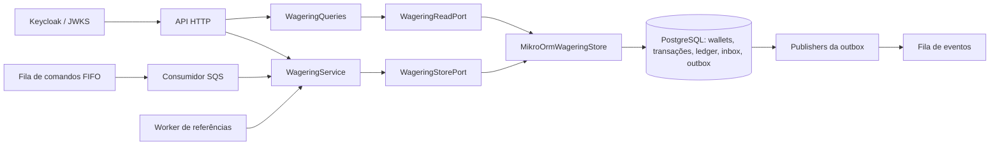

# Arquitetura do Distributed Wagering Processor

## Responsabilidades e execução

O PostgreSQL é a autoridade sobre saldo, identidade das operações e efeitos financeiros. HTTP, consumidor SQS e worker de referências usam o mesmo `WageringService`. A correção não depende de memória compartilhada, da ordem das requisições nem da deduplicação do broker.



A API NestJS roda em processos Bun separados. `worker.ts` permite executar consumidor, publisher e referências juntos ou escolher um papel com `WORKER_ROLE`. Cada processo abre seu próprio pool PostgreSQL. Isso permite escalar os papéis separadamente; a unidade de concorrência financeira continua sendo a wallet.

Os diretórios separam domínio, aplicação, HTTP, persistência, mensageria, autenticação e observabilidade. O domínio e os casos de uso `WageringService`/`WageringQueries` não importam NestJS, MikroORM ou SQL. O serviço coordena as entidades por um port transacional específico; as consultas usam um port de leitura. O adapter `MikroOrmWageringStore` implementa ambos, e as factories de infraestrutura fazem a composição no HTTP, workers e testes. O runtime compila TypeScript antes de executar para preservar metadata de decorators exigida pelo NestJS.

`ObservedWageringService` e `ObservedWageringQueries` envolvem os casos de uso por composição. Logs e métricas ficam nessa borda; falhas de diagnóstico não substituem um resultado confirmado nem o erro original de uma execução desfeita.

## Dinheiro e modelo de domínio

`Money` guarda centavos em `bigint`, com moeda separada. Entrada e saída usam strings decimais com exatamente duas casas. Não há conversão de dinheiro para `number`, arredondamento implícito ou representação em ponto flutuante. Strings vazias, valores numéricos, notação científica, `NaN`, `Infinity`, escala diferente de duas casas e negativos em contratos de entrada são recusados.

O limite financeiro é `9223372036854775807` centavos, correspondente ao máximo positivo de `BIGINT`. Operações internas podem produzir valores negativos dentro do intervalo simétrico, por exemplo na diferença de reconciliação. Parsing e aritmética verificam o limite antes do SQL. `Money` é imutável; somar, subtrair ou negar retorna outra instância. Operações entre moedas diferentes falham.

A aplicação abre wallets apenas em `BRL`. O modelo monetário continua aceitando outras moedas e testa conflitos entre elas. Uma submissão com moeda válida, mas diferente da wallet, pode ser registrada como rejeitada para manter a tentativa auditável.

`Wallet` encapsula saldo, versão e atualização. Crédito e débito exigem valor positivo; débito nunca pode produzir saldo negativo. A versão usa o mesmo limite do `INTEGER` PostgreSQL: `2147483647`. A última transição até esse valor é permitida; movimentos posteriores recebem `WALLET_VERSION_OVERFLOW` antes de alterar saldo, versão ou timestamp. A factory do ledger aplica o mesmo limite.

As entidades usam construtores privados e factories explícitas. `create`/`open` validam criação e transições; `rehydrate` reconstrói estado persistido sem reaplicar regras de transição. Datas são copiadas na entrada e nos getters. O ledger é imutável também em memória e sua factory valida a aritmética `saldo anterior ± valor = saldo posterior`.

Toda wallet nasce na versão 1. Abertura positiva cria uma transação interna `OPENING`, um crédito no ledger na versão 1 e os eventos correspondentes. Abertura zero mantém a versão 1 sem criar transação financeira ou lançamento. Nesse caso, o primeiro movimento financeiro usa a versão 2. `LOSS` não altera versão.

## Transação SQL e concorrência

Cada comando usa `WageringStorePort.transaction()`. O adapter cria um `EntityManager.fork().transactional()` e um contexto próprio para as operações de inbox, transação, wallet, ledger e outbox. O port expõe operações específicas de persistência e lock; o caso de uso decide as transições e os eventos sem receber um `EntityManager` ou executor SQL. O hook de falha `beforeCommit`, usado pelos testes, roda no Unit of Work depois do callback e antes do commit.

O mapeamento MikroORM `WalletRecord` usa `BigIntType('bigint')`, e o agregado é reconstruído com `Money.fromMinorUnits`. O Unit of Work mantém o registro da wallet carregado sob lock e persiste suas mudanças. Inserts, idempotência, ledger, inbox e outbox usam SQL explícito pelo mesmo `EntityManager`. As operações de lease do publisher têm suas próprias transações, posteriores ao commit financeiro.

A ordem de aquisição dos locks é consistente:

1. Inbox por `(consumerName, messageId)`, quando a entrada vem da fila.
2. Transação própria por idempotency key, com `FOR UPDATE`.
3. Wallet com `FOR NO KEY UPDATE`.

O lock da wallet serializa movimentos na mesma conta. Wallets diferentes não compartilham um lock global. `NO KEY UPDATE` é intencional: inserir uma transação com FK para a wallet adquire `KEY SHARE`. Usar depois `FOR UPDATE` em duas apostas distintas poderia criar um deadlock de promoção de locks. `NO KEY UPDATE` é compatível com essas verificações de FK e impede movimentos concorrentes sobre saldo e versão, que não são colunas de chave.

Referências são lidas sem lock próprio depois do lock da wallet. Uma referência válida pertence à mesma wallet; operações terminais não mudam mais de estado. Referências pendentes aguardam em vez de criar uma cadeia de locks entre transações. Replays terminais devolvem o resultado salvo sem adquirir lock financeiro da wallet.

Saldo, transação, ledger, resposta persistida, inbox aplicável e eventos da outbox são confirmados juntos. Falha antes do commit desfaz o conjunto completo. A publicação SQS acontece em outro fluxo, depois desse commit.

### Garantias do schema

O schema aplica, além das validações da aplicação:

- Unicidade de wallet por jogador/moeda, idempotency key global e identidade `(providerId, externalTransactionId)`.
- Um lançamento por transação/wallet e uma entrada por versão da wallet.
- Uma única reversão processada por `referenceTransactionId`, independentemente de ser REFUND ou ROLLBACK.
- Inbox única por consumidor/mensagem; outbox identificada pelo `eventId` persistido.
- Saldos não negativos, valores financeiros exatos, aritmética dos lançamentos e relações por FK.
- Proibição de `UPDATE`, `DELETE` e `TRUNCATE` no ledger; proibição de alteração ou exclusão de transações terminais.
- Imutabilidade dos campos de negócio e de `created_at` da transação, inclusive enquanto ela aguarda referência.

Triggers diferidos conferem a correspondência entre transação processada e ledger, direção, valor, identidade da wallet e referência, continuidade entre versões e igualdade entre o último saldo do ledger e o saldo materializado. Essas verificações usam buscas indexadas pela transação ou pela versão anterior/mais recente da wallet. O processamento de cada aposta não soma o histórico inteiro. Um trigger diferido adicional verifica o sucessor da abertura: ele impede inserir uma abertura retroativa na versão 1 depois de uma wallet zerada já ter recebido seu primeiro movimento na versão 2. Abertura e movimento seguinte na mesma transação SQL continuam permitidos quando os saldos são contíguos. O bloqueio de `TRUNCATE` também protege a exclusão em massa do ledger.

A FK da transação exige que a wallet exista. A identidade completa de jogador/moeda é conferida para transações processadas, permitindo persistir tentativas rejeitadas por divergência de identidade. Uma wallet inexistente resulta em `404`, sem registro de aposta: não é possível criar esse registro respeitando a FK.

Migrations são versionadas e reversíveis. Os testes executam ida/volta e tentam violações diretamente por SQL, incluindo mutação do ledger e mudanças de saldo sem lançamento correspondente.

Há cinco migrations. A `Migration20261026000200` protege a identidade da operação — provedor, id externo, key, hash, wallet, jogador, rodada, jogo, tipo, valor, moeda e referência externa — e sua criação persistida. Também bloqueia `DELETE` de `PROCESSED`, `REJECTED` e `FAILED`. Assim, uma exclusão SQL não pode apagar uma rejeição terminal e permitir que o mesmo envio seja processado depois com outro saldo. Status, resultado e agenda de retry continuam atualizáveis pelas transições permitidas enquanto a operação não é terminal.

## Idempotência e resposta original

O header `Idempotency-Key` é obrigatório no HTTP e é a fonte da verdade. Na fila, o consumidor fornece ao mesmo caso de uso a key presente em `data.idempotencyKey`.

O hash é SHA-256 de JSON canônico: chaves de objetos são ordenadas recursivamente, e a ordem de arrays é preservada. O subconjunto de negócio contém provedor, identidade externa, jogador, wallet, rodada, jogo, tipo, dinheiro normalizado e referência externa quando informada. Header, envelope SQS e outros metadados de transporte não entram nesse hash.

Identificadores e keys com sequências UTF-16 malformadas são rejeitados antes do hash e da persistência. Emojis e pares de surrogates válidos são preservados. Formas Unicode composta e decomposta permanecem identidades distintas; não há normalização implícita que altere os ids do provedor no percurso até o PostgreSQL.

O insert usa `ON CONFLICT DO NOTHING`, e a execução consulta e bloqueia a linha da key. Payload divergente na mesma key resulta em `IDEMPOTENCY_CONFLICT`. Reutilizar a identidade externa do provedor com outra key resulta em `EXTERNAL_IDENTITY_CONFLICT`. Nenhum desses casos é tratado como replay.

O resultado terminal salvo inclui id interno, status, saldo observado naquele processamento e código de falha quando existente. Replay devolve esse snapshot com `idempotentReplay: true`, mesmo que outras operações já tenham alterado a wallet. `PROCESSED`, `REJECTED` e `FAILED` são terminais; `PENDING` e `PENDING_REFERENCE` ainda podem transicionar.

Uma aceitação pendente não congela o processamento financeiro: retry HTTP pode tentar resolver novamente a referência usando o mesmo id e a mesma data de criação. A inbox tem outra responsabilidade: uma mensagem já aceita e confirmada mantém seu snapshot de aceitação, inclusive `PENDING_REFERENCE`, e pode receber ack. O worker de referências conclui a operação independentemente do redelivery dessa mensagem.

## Operações e referências

| Operação | Efeito | Regra adicional |
| --- | --- | --- |
| `BET` | Débito | Exige saldo suficiente. |
| `WIN` | Crédito | Referência BET opcional; payout pode diferir do valor apostado. |
| `LOSS` | Nenhum | Aceita zero ou positivo; emite processamento sem ledger, mudança de saldo ou versão. |
| `REFUND` | Crédito | Exige BET processada e reversão integral. |
| `ROLLBACK` | Inverso da referência | Reverte BET por crédito e WIN/REFUND por débito, sempre pelo valor integral. |

Quando informada, a referência é resolvida por provedor e id externo, e precisa corresponder a jogador, wallet, moeda e rodada. Referências ausentes ou pendentes deixam a operação em `PENDING_REFERENCE`. Referência rejeitada ou permanentemente falha causa uma rejeição específica. Autorreferência é contrato inválido.

Não existe exclusividade adicional entre WIN e LOSS da mesma BET. Uma referência só pode ter **uma reversão processada**, considerando REFUND e ROLLBACK em conjunto. Depois de BET de `25.00` e REFUND, um ROLLBACK que ainda referencia a BET recebe `REVERSAL_ALREADY_PROCESSED`, sem novo crédito. Para desfazer o REFUND, o ROLLBACK deve referenciar o próprio REFUND e debitar seu valor; isso não torna a BET original reversível novamente. WIN e LOSS que referenciam a BET não contam como reversões, e tentativas rejeitadas não consomem a referência. A aplicação verifica a exclusividade sob lock da wallet antes dos efeitos, e o índice único parcial em `reference_transaction_id` reforça a garantia no banco.

A migration `Migration20261026000100` substitui o índice de reversão por referência/tipo sem reescrever transações ou ledger. Se o banco já contiver REFUND e ROLLBACK processados sobre a mesma referência, a criação do índice falha e a migration inteira é desfeita, preservando dados e índice anterior. Esse histórico exige auditoria financeira e uma estratégia explícita de migração; não há reparo automático. A atualização deve ser coordenada para retirar os writers com a regra antiga antes de retomar o processamento.

Reversão parcial é rejeitada. Um rollback que precisaria debitar mais que o saldo disponível recebe `REVERSAL_INSUFFICIENT_FUNDS`, distinto de `INSUFFICIENT_FUNDS` de BET. A rejeição permanece persistida sem ledger ou mudança de versão.

O worker de referências seleciona linhas vencidas sem reter locks e chama `reprocess`. O caso de uso bloqueia a própria transação e confere novamente status e `next_attempt_at`; assim, dois workers que selecionaram a mesma linha não contabilizam duas tentativas. O backoff persistido começa em 1 segundo, dobra e limita em 60 segundos. Retry HTTP pode antecipar uma tentativa, mas nunca renova a criação persistida.

O TTL é de 24 horas desde `created_at`, fornecido pelo banco. Tanto HTTP quanto worker comparam esse instante com o relógio PostgreSQL. Ao expirar, a operação vira `REJECTED/REFERENCE_EXPIRED` e gera o evento de rejeição. O evento de pendência é emitido apenas na primeira transição para pendência, não em cada tentativa.

## Contratos HTTP e códigos estáveis

| HTTP | Significado |
| --- | --- |
| `201` | Wallet criada. |
| `200` | Transação processada, inclusive LOSS e replay processado; consultas e reconciliação concluídas. |
| `202` | Aceita com processamento pendente. |
| `400` | Contrato, escala, tipo, referência exigida, identificador ou cursor inválido. |
| `401` / `403` | Token inválido ou escopo/role insuficiente. |
| `404` | Wallet ou transação inexistente. |
| `409` | Identidade de wallet, idempotência, identidade externa ou inbox conflitante. |
| `413` | Corpo da requisição excede o tamanho permitido. |
| `415` | Charset ou codificação do corpo não suportado. |
| `422` | Rejeição financeira ou de referência, incluindo replay rejeitado. |
| `500` | Erro de programação, invariante violada ou falha interna não reconhecida como transitória. |
| `503` | Falha transitória reconhecida de infraestrutura, incluindo acesso ao JWKS; também é usado para um resultado terminal `FAILED`, identificado pelo corpo com `status` e `failureCode`. |

`ApplicationError` carrega categoria, código, mensagem e causa, sem status HTTP. O filtro da borda traduz as categorias para HTTP e distingue falhas reconhecidas de conexão, timeout e lock de erros internos. JSON malformado recebe `400`; tamanho, charset e codificação são tratados nos respectivos códigos acima. SQL, mensagens do driver e causas internas não são serializados na resposta.

As respostas de erro de contrato/infraestrutura usam `code` e `message`. Resultados financeiros rejeitados ou falhos usam `transactionId`, `status`, `balance`, `failureCode` e `idempotentReplay`. O cliente deve inspecionar esse resultado terminal antes de decidir reenviar; repetir uma operação `FAILED` não reabre seu estado.

| Grupo | Códigos relevantes |
| --- | --- |
| Contrato | `INVALID_REQUEST`, `INVALID_MONEY`, `INVALID_CURRENCY`, `UNSUPPORTED_CURRENCY`, `INVALID_TRANSACTION_KIND`, `INVALID_TRANSACTION_AMOUNT`, `INVALID_REFERENCE`, `REFERENCE_REQUIRED`, `INVALID_PROVIDER`, `INVALID_CURSOR`, `PAYLOAD_TOO_LARGE`, `UNSUPPORTED_MEDIA_TYPE`. |
| Identidade/conflito | `WALLET_ALREADY_EXISTS`, `IDEMPOTENCY_CONFLICT`, `EXTERNAL_IDENTITY_CONFLICT`, `INBOX_MESSAGE_CONFLICT`. |
| Saldo/modelo | `INSUFFICIENT_FUNDS`, `REVERSAL_INSUFFICIENT_FUNDS`, `CURRENCY_MISMATCH`, `WALLET_PLAYER_MISMATCH`, `MONEY_OVERFLOW`, `WALLET_VERSION_OVERFLOW`. |
| Referência | `REFERENCE_MISMATCH`, `REFERENCE_REJECTED`, `REFERENCE_FAILED`, `INVALID_REFERENCE_KIND`, `REFERENCE_AMOUNT_MISMATCH`, `REVERSAL_ALREADY_PROCESSED`, `REFERENCE_EXPIRED`. |
| Recursos/infraestrutura | `WALLET_NOT_FOUND`, `TRANSACTION_NOT_FOUND`, `INFRASTRUCTURE_UNAVAILABLE`, `DEPENDENCIES_UNAVAILABLE`, `IDENTITY_PROVIDER_UNAVAILABLE`. |
| Execução interna | `INTERNAL_ERROR`. |
| Autorização | `INVALID_ACCESS_TOKEN`, `INSUFFICIENT_ROLE`, `PROVIDER_ACCESS_DENIED`. |
| Mensageria | `INVALID_COMMAND_ENVELOPE`, `INVALID_COMMAND`, `RETRY_EXHAUSTED`, `PROCESSING_FAILED`, `ACK_FAILED`, `SQS_CALL_TIMEOUT`, `OPERATION_CANCELLED`; falhas permanentes preservam o código auditado. |

`MONEY_OVERFLOW` pode aparecer como `400` quando o próprio valor de entrada excede o limite, ou como rejeição financeira quando uma operação válida faria o saldo ultrapassá-lo. Códigos de erro de programação, como tentativa de alterar entidade terminal, não são convertidos em rejeições financeiras silenciosas.

## Inbox, SQS e recuperação

As filas são `wager-transactions.fifo`, `wager-transactions-dlq.fifo` e a fila standard `wager-events`, separada para eventos. FIFO auxilia a ordenação dos comandos; o banco continua responsável pela correção. Os testes enviam o mesmo id lógico com deduplication ids distintos para exercitar a inbox sem depender da janela de deduplicação FIFO.

O hash da inbox inclui a idempotency key e os campos canônicos de negócio. Reutilizar `(consumerName, messageId)` com outra key ou payload gera conflito permanente. Marcar a inbox como processada participa da mesma transação financeira, inclusive quando a operação já havia sido processada por HTTP e a entrada SQS apenas registra o replay.

O cliente SQS configura timeout de conexão de 3 segundos, timeout efetivo de requisição de 25 segundos com `throwOnRequestTimeout: true` e no máximo três tentativas do SDK. `sqsCall` acrescenta um deadline total de 30 segundos que inclui essas tentativas e seus backoffs, com cancelamento explícito. Esse limite comporta o long poll de 20 segundos. Operações de heartbeat e cleanup usam orçamentos menores. O número de tentativas do SDK é independente do limite de recebimentos do consumidor.

O consumidor faz ack depois que o caso de uso retorna do commit. Rejeição de negócio é terminal e recebe ack; infraestrutura transitória recebe retry com visibilidade/backoff. O limite padrão é cinco recebimentos. Envelope inválido e falhas permanentes seguem para DLQ; esgotamento usa `RETRY_EXHAUSTED`.

Quando o comando é válido e o banco está acessível, `failSubmission` persiste `FAILED`, snapshot, inbox e `WagerTransactionFailed` sem aplicar dinheiro. Essa auditoria não substitui resultado terminal anterior: falhar o ack de uma aposta já processada não pode transformá-la em FAILED. Se o banco estiver indisponível, o original pode chegar à DLQ sem auditoria SQL de FAILED; corpo e metadados do broker permanecem a evidência recuperável.

Falha em `DeleteMessage` depois do commit é identificada como `ACK_FAILED`, com `failureStage: ack` e `causeCode` de transporte sanitizado. Ela não altera status, código de falha ou saldo original persistidos. Retry e DLQ carregam os ids e o status financeiro observado; os metadados distinguem falha de processamento de falha de confirmação. Um replay de `FAILED` precisa ser encaminhado à DLQ antes do ack, preservando o código terminal original quando a publicação anterior falhou. O corpo original permanece disponível para recuperação, e a deduplication id da publicação na DLQ é estável por mensagem e código.

A visibilidade é renovada enquanto a mensagem está em andamento, inclusive durante ack e publicação na DLQ. Em `SIGTERM`, os papéis param de admitir trabalho novo, cancelam receives e compartilham uma única janela de drenagem de dez segundos em paralelo. O cleanup padrão dispõe de três segundos para devolver visibilidade e liberar leases ainda pertencentes ao processo; ele fica dentro do orçamento restante anterior ao watchdog de quinze segundos. Um handler que termina depois da devolução não pode fazer ack com aquela posse antiga; os locks e a idempotência protegem uma eventual sobreposição financeira.

O watchdog permanece ativo durante o fechamento do servidor operacional e do pool SQL. Se uma consulta bloqueada impedir o encerramento, o processo termina com código `1` ao atingir o deadline. Uma limpeza que não consegue concluir deixa a visibilidade ou o lease finito expirar para outra instância retomar o trabalho.

## Outbox e entrega de eventos

Os eventos têm subclasses concretas e envelope versionado: `WagerTransactionProcessed`, `WagerTransactionRejected`, `WagerTransactionPendingReference`, `WalletBalanceChanged` e `WagerTransactionFailed`. Dinheiro no payload já está serializado em strings. `WalletBalanceChanged` existe somente quando há mudança efetiva de saldo.

Publishers concorrentes reivindicam lotes com `FOR UPDATE SKIP LOCKED`, gravam lease e token de posse e fazem o envio fora da transação de reivindicação. O lease é renovado durante o trabalho. Atualizações de sucesso/retry conferem id, token e, no sucesso, lease ainda válido. Um publisher que perde a posse não pode registrar sucesso usando um token antigo; um lease abandonado permite que outro processo retome o envio.

A entrega é **at-least-once**. Se o SQS aceitar um evento e o processo morrer antes de gravar `published_at`, haverá republicação. O `eventId` e o payload originais são preservados. Consumidores downstream precisam deduplicar por `eventId`; a solução não promete entrega exactly-once. Eventos da fila standard também podem chegar fora de ordem. `walletVersion` nos eventos de saldo permite ao consumidor reconhecer a sequência financeira.

Falha de envio agenda retry persistido; o registro confirmado na outbox não é removido. A reconciliação do saldo não depende da disponibilidade do broker.

Produção e experimento de carga usam `publisherConfiguration` e `runPublisherLoop`. O lote padrão contém dez eventos, configurável de 1 a 100 por `OUTBOX_BATCH_SIZE`, com lease de 30 segundos. Um lote produtivo é seguido imediatamente pelo próximo. Um ciclo sem publicação espera 250 ms; erro de ciclo espera um segundo. As esperas são canceláveis no desligamento. Isso mantém a mesma política de publicação nos workers e no teste de carga.

## Consultas, observabilidade e autenticação

O ledger usa cursor opaco contendo wallet, última versão lida e teto de versões da primeira página. Novos lançamentos não deslocam o histórico já em navegação. A reconciliação usa uma única instrução SQL para ler saldo materializado e soma do ledger no mesmo snapshot PostgreSQL, inclusive durante escritas concorrentes. Ela devolve diferença e consistência, registra divergências e não corrige saldos silenciosamente.

Logs JSON incluem os identificadores disponíveis de correlação, mensagem, transação, wallet e provedor, além de status, código e duração. Identificadores válidos são capturados antes da execução para permanecerem disponíveis em falhas de SQL e transporte; depois do processamento, o id da transação é a correlação do resultado. A escrita usa uma lista explícita de campos; não registra payload financeiro completo, saldos, tokens ou segredos. Os wrappers isolam falhas dos contadores, histogramas e do destino dos logs: diagnósticos não alteram o resultado financeiro confirmado nem mascaram o erro original de um rollback.

As métricas Prometheus cobrem resultados por status, duplicatas, retries, DLQ, conflitos de lock, inconsistências de reconciliação, latência e idade do evento mais antigo da outbox. Contadores e histogramas são locais a cada processo e reiniciam com ele; devem ser coletados de todas as instâncias. A contagem por status representa execuções observadas, e uma nova tentativa pendente pode ser contada novamente. O lag da outbox é consultado no banco.

Cada publisher contabiliza eventos confirmados como publicados, falhas de ciclo, retries e perdas de lease em métricas próprias do processo. Os labels têm valores limitados; ids de wallet, jogador ou transação não viram dimensões Prometheus. Observações do consumidor e metadados da DLQ separam `failureStage` e `causeCode`; os logs registram o código operacional e a causa de transporte em eventos correlacionados.

A API expõe `/metrics` para operador. Cada worker abre um servidor operacional em `127.0.0.1`, com porta configurável por `WORKER_METRICS_PORT`; a porta padrão `0` é dinâmica e o endereço aparece no log de inicialização. Esse endpoint local precisa de coleta por instância e não agrega o cluster.

`/health/live` verifica vida do processo. `/health/ready` verifica PostgreSQL e acesso às filas de comandos/eventos SQS. Readiness falha com `503` se as dependências não estão alcançáveis. Os dois health checks permanecem públicos.

A autenticação HTTP integra Keycloak por OIDC, usando `client_credentials`. O verificador exige assinatura RS256 válida, issuer, audience, expiração e claims de service account. As chaves públicas vêm do JWKS. Não existe tabela própria de senhas.

A leitura do JWKS tem timeout de três segundos e cache de cinco minutos. Chaves já válidas no cache podem continuar verificando tokens durante uma indisponibilidade. Falha de rede, timeout, resposta HTTP inesperada, JSON malformado ou material JWKS inválido recebem `503/IDENTITY_PROVIDER_UNAVAILABLE`. Assinatura, claims ou chave de assinatura desconhecida em um JWKS válido continuam sendo falhas de autenticação `401`.

Um cliente com role `dwp-provider` só submete operações com seu `providerId` e consulta suas próprias transações. A role `dwp-operator` administra/consulta wallets, ledger, reconciliação e métricas, e pode consultar transações dos provedores. Um token de operador não substitui a identidade de provedor para submeter apostas. A autorização compara identidade do token com body, path ou transação consultada conforme a rota.

Autenticação só é desativada quando `AUTH_ENABLED=false` está explícito para desenvolvimento/testes; sem essa opção, a configuração OIDC é obrigatória. SQS é um canal interno confiável quanto ao transporte, mas o provedor e os demais campos da mensagem passam pelas mesmas validações financeiras.

## Evidências e limites

As execuções finais registraram **250 testes aprovados: 87 unitários, 159 de integração e 4 de autenticação**. A suíte cobre parsing/limites, estados terminais, regras financeiras, SQL direto e migrations, 50 submissões paralelas da mesma aposta, duas apostas de `80.00` disputando `100.00`, wallets independentes e três processos reais. As regressões de reversão verificam REFUND seguido de ROLLBACK e a ordem inversa, a disputa concorrente entre os tipos, reprocessamento de referências pendentes, replay da rejeição, ROLLBACK do próprio REFUND e a proteção do índice por SQL direto. A migration de unicidade é testada em ida/volta e com histórico incompatível, sem alteração de dados financeiros.

O modelo financeiro independente usa centavos inteiros, estados e regras próprios, sem importar `Money`, entidades ou helpers da implementação. Três seeds fixas (`424242`, `424243`, `424244`) geram trinta sequências cada, com três wallets e no máximo trinta comandos por sequência. A execução registrada percorreu **90 sequências e 1.491 comandos** em PostgreSQL real, incluindo todos os tipos, conflitos, replays e snapshots pendentes da inbox. As chamadas alternam o caso de uso sem contexto de inbox e com esse contexto; a entrega pelo broker é coberta pelas integrações SQS separadas. Os testes informam seed e caminho de reprodução da sequência em caso de divergência.

A refatoração para ports e adapter foi conferida com os mesmos cenários financeiros e com o modelo independente. Uma comparação estática confirmou a preservação dos 21 literais SQL distintos de escrita e consulta, além da revisão da ordem dos locks e da consulta única de reconciliação.

Os cenários de falha incluem rollback antes do commit, redelivery após commit antes do ack, dois publishers, retomada de leases, indisponibilidade de PostgreSQL/SQS, timeout de long poll e ack, desligamento com SQL bloqueado, falhas dos destinos de diagnóstico, referências fora de ordem, expiração e disputa de reprocessamento com HTTP. Os testes de crash usam processos separados e `SIGKILL` em pontos antes/depois do envio e depois do commit antes do ack. Os cenários financeiros conferem reconstrução do saldo pelo ledger, ausência de efeitos duplicados e não negatividade.

Limites assumidos:

- Runtime de aplicação em BRL, embora `Money` modele múltiplas moedas.
- Ledger de movimentos por wallet; não implementa contabilidade de partidas dobradas.
- Versão financeira limitada ao `INTEGER` SQL, com rejeição explícita antes de exceder `2147483647`.
- Identidade de wallet inexistente gera `404` sem transação de aposta persistida.
- Uma indisponibilidade do banco pode impedir auditoria SQL de FAILED antes da DLQ; a mensagem original permanece no broker.
- Métricas são por processo. A fila de eventos exige deduplicação e tratamento de desordem pelos consumidores externos.
- A integração e o experimento de carga usam PostgreSQL e MiniStack locais. Não medem latência de rede, limites, operação multi-AZ ou comportamento de produção do AWS SQS.

## Experimento de carga

`bun run test:load` cria banco e fila de eventos isolados e inicia **três processos de API e dois processos reais de publisher**. Os publishers executam o entrypoint normal com o mesmo leitor de configuração e o mesmo loop usado fora do teste: lote padrão de **10**, lease de `30s`, espera de `250ms` apenas em ciclos sem publicação e de `1s` após erro. Não há override oculto de lote no runner.

Cada execução percorre wallet disputada e wallets independentes, com concorrências `1`, `10` e `50`, **15 segundos de aquecimento e 60 segundos de medição** por combinação. Cada cliente mantém uma requisição em andamento e afinidade com uma API. O tráfego contém BETs de `0.01 BRL`; os identificadores são únicos. O aquecimento fica fora dos percentis e do throughput, mas seus contadores são preservados para conferir o total de apostas persistidas.

O relatório registra ambiente, PIDs/configuração, throughput, p50/p95/p99, erros, replays, conflitos de lock, deadlocks, outbox lag/backlog, métricas individuais dos publishers e recursos dos processos. Antes de declarar sucesso, exige respostas válidas sem erros/replays inesperados, correspondência entre requisições bem-sucedidas e apostas persistidas, processos vivos, reconciliação e drenagem dentro do orçamento. Eventos publicados depois desse orçamento durante o shutdown não convertem uma drenagem tardia em sucesso.

### Ambiente e reprodução

Foram realizadas **três execuções completas e sequenciais em 26/10/2026**, sem outras suítes ou cargas concorrentes. As medições correspondem ao commit `960f8d7877fa881de23571d7ca5ed47eeb096fcd`; a documentação foi concluída depois das medições. Os horários abaixo usam **BRT / America/Sao_Paulo (UTC−03)**.

| Parâmetro | Ambiente medido |
| --- | --- |
| CPU | AMD EPYC 9V45; 5 CPUs lógicas visíveis, quota efetiva de 4 vCPU (`cpu.max = 400000 100000`). |
| Memória | Limite de cgroup de 16 GiB (`17179869184` bytes). |
| Sistema/runtime | Linux 6.18.55 x64; Bun 1.4.4. |
| Stack | NestJS 12.2.0, MikroORM 7.2.5, PostgreSQL 17.6-alpine, AWS SDK SQS 3.1156.0 e MiniStack 1.5.32. |
| Processos | 3 APIs e 2 publishers separados, todos vivos até o fim; cada publisher terminou com código 0. Driver, banco e broker no mesmo host. |
| Publisher | `OUTBOX_BATCH_SIZE=10`, lease de 30 s, espera ociosa de 250 ms, espera após erro de 1 s. |
| Autenticação | Desativada explicitamente na carga; Keycloak validado separadamente pela suíte de autenticação. |
| Drenagem | Orçamento de 60 s em todas as execuções, sem ampliação. |

```bash
for load_run in 1 2 3
do
  LOAD_WARMUP_SECONDS=15 LOAD_DURATION_SECONDS=60 LOAD_OUTBOX_DRAIN_SECONDS=60 OUTBOX_BATCH_SIZE=10 \
    LOAD_REPORT_PATH="load-results-${load_run}.json" bun run test:load
done
```

### Resultados por execução

| Execução | Início BRT | Fim BRT | Requisições medidas | Apostas com aquecimento | Eventos publicados | Drenagem s |
| --- | --- | --- | ---: | ---: | ---: | ---: |
| 1 | 11:21:12 | 11:29:42 | 122.184 | 152.299 | 304.726 | 54,8540 |
| 2 | 11:29:44 | 11:38:11 | 119.260 | 147.958 | 296.044 | 52,1400 |
| 3 | 11:38:13 | 11:46:43 | 122.160 | 152.339 | 304.806 | 55,6187 |

Identificadores dos relatórios:

- Execução 1: `90f553d7-cdc7-42ef-bc57-938c8ad2ef76`.
- Execução 2: `5d377cdf-ebfc-43d1-ad09-afa4f71629e0`.
- Execução 3: `f5420872-d635-438e-8da1-25a645e55e28`.

Cada linha seguinte é uma janela de medição após o aquecimento. RPS usa o tempo efetivo até concluir as requisições em andamento. Latências estão em milissegundos; lag é a idade do evento pendente mais antigo, em segundos. Os percentis usam buckets de 1 ms; os máximos de lag/backlog são amostrados a cada segundo.

| Execução | Cenário | Clientes | RPS | p50 ms | p95 ms | p99 ms | Erros | Maior lag s | Pico pendente |
| --- | --- | ---: | ---: | ---: | ---: | ---: | ---: | ---: | ---: |
| 1 | Wallet disputada | 1 | 264,4 | 3 | 10 | 14 | 0 | 0,261197 | 176 |
| 1 | Wallet disputada | 10 | 205,7 | 30 | 158 | 256 | 0 | 0,277129 | 152 |
| 1 | Wallet disputada | 50 | 125,6 | 317 | 966 | 1.429 | 0 | 0,292297 | 98 |
| 1 | Wallets independentes | 1 | 252,1 | 3 | 10 | 14 | 0 | 0,270660 | 196 |
| 1 | Wallets independentes | 10 | 476,9 | 19 | 38 | 49 | 0 | 19,260716 | 19.848 |
| 1 | Wallets independentes | 50 | 710,0 | 70 | 107 | 134 | 0 | 66,329434 | 93.020 |
| 2 | Wallet disputada | 1 | 265,6 | 3 | 9 | 14 | 0 | 0,251414 | 166 |
| 2 | Wallet disputada | 10 | 206,6 | 29 | 160 | 256 | 0 | 0,253202 | 144 |
| 2 | Wallet disputada | 50 | 129,7 | 308 | 918 | 1.343 | 0 | 0,301530 | 92 |
| 2 | Wallets independentes | 1 | 258,8 | 3 | 9 | 13 | 0 | 0,255064 | 186 |
| 2 | Wallets independentes | 10 | 485,3 | 19 | 37 | 46 | 0 | 17,669077 | 18.299 |
| 2 | Wallets independentes | 50 | 639,8 | 78 | 120 | 149 | 0 | 66,665603 | 84.130 |
| 3 | Wallet disputada | 1 | 271,0 | 3 | 9 | 14 | 0 | 0,250024 | 204 |
| 3 | Wallet disputada | 10 | 210,4 | 30 | 158 | 243 | 0 | 0,261840 | 150 |
| 3 | Wallet disputada | 50 | 121,6 | 326 | 986 | 1.477 | 0 | 0,316770 | 90 |
| 3 | Wallets independentes | 1 | 256,0 | 3 | 10 | 14 | 0 | 0,485616 | 257 |
| 3 | Wallets independentes | 10 | 490,5 | 19 | 37 | 46 | 0 | 18,148486 | 18.284 |
| 3 | Wallets independentes | 50 | 684,8 | 73 | 107 | 129 | 0 | 66,492307 | 90.150 |

As três execuções concluíram **363.604 requisições medidas**, todas `HTTP 200 / PROCESSED`. Somando **88.992 apostas de aquecimento**, foram **452.596 BETs**, **192 wallets reconciliadas**, **452.788 lançamentos** e **905.576 eventos marcados como publicados**. Todas as keys, identidades externas e efeitos de ledger eram únicos; não houve saldo negativo, efeito financeiro duplicado ou divergência. Os contadores individuais dos publishers somaram o total publicado, e as contagens aproximadas das filas locais foram compatíveis.

Houve zero erros de tráfego, replays inesperados, conflitos de lock reportados, deadlocks PostgreSQL, retries de publisher, perdas de lease ou falhas de ciclo. Todas as amostras de recursos/lag foram coletadas. As três outboxes zeraram **antes do limite de 60 s**, com `remainingAtDrainDeadline=0`, e continuaram sem pendências depois do encerramento dos processos.

### Interpretação e alcance

Na wallet disputada, os três resultados com 50 clientes ficaram entre **121,6 e 129,7 RPS**, com p99 entre **1.343 e 1.477 ms**. A serialização protege o saldo; elevar a concorrência aumenta a espera pelo agregado. Zero erros de conflito não significa ausência de espera por locks.

Wallets independentes com 50 clientes ficaram entre **639,8 e 710,0 RPS**, com p99 entre **129 e 149 ms**. Nesse pico, a publicação ficou atrás da entrada financeira: os backlogs finais foram 93.020, 84.130, 90.150 eventos nas execuções 1, 2 e 3. O maior pico foi **93.020 eventos**, e o maior lag observado foi **66,665603 s**. Tudo foi preservado e drenado após a interrupção do tráfego. Isso comprova recuperação dentro da janela deste experimento; não demonstra estabilidade indefinida sob a mesma taxa de entrada.

As janelas de maior concorrência já começaram com eventos pendentes dos aquecimentos e cenários anteriores. Banco e fila são novos entre execuções, mas crescem dentro de cada execução, em ordem fixa. As três repetições mostram a variação local; não representam uma comparação estatística de capacidade de produção. Não há meta artificial de RPS.

API, driver, publishers, PostgreSQL e MiniStack compartilham a quota de CPU. CPU, I/O e esperas não foram isolados com granularidade suficiente para atribuir um gargalo específico ao runtime, ORM ou broker. O dimensionamento deve considerar separadamente a capacidade de confirmação financeira e a de publicação.

O tráfego é fechado: cada cliente espera a resposta antes da próxima requisição e mantém afinidade com uma API, sem balanceador real. O teste usa apenas BETs, autenticação desativada e MiniStack local, sem latência externa, limites reais do AWS SQS ou topologia multi-AZ. Também não mede o consumo downstream dos eventos. Esses limites e a resolução de 1 ms restringem a generalização das latências e vazões.

Os relatórios JSON completos são gravados em `LOAD_REPORT_PATH`, cujo padrão é `load-results.json`, e permanecem fora do Git. Os resultados e condições relevantes das três execuções estão registrados acima.
